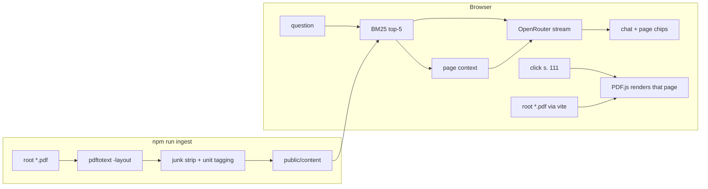

# Study O'Clock

A fullscreen ambient clock with a Pomodoro ring, five dark themes or a sun-driven dynamic mode, and a
study workspace grounded in your own 9th-grade textbooks.

```
c  çalışma alanı   s  ayarlar       f  tam ekran
p  pomodoro        shift+p sıfırla  d  loş mod
b  ekran koruma    esc  kapat
```

## Why it exists

The clock is the product: glass over a dark gradient, huge tabular numerals, and details (seconds,
date, timezone, sun phase, streak) that fade in when you move the mouse and disappear when you don't.
While a Pomodoro session runs, a thin arc traces the panel edge and the remaining time sits under the
date.

The workspace is the useful part: press `c` for a full-screen study surface with your books on the
left, the clock in the header, and a coach that answers from *your* textbooks — citing the exact page,
which you can open as the real document.

## Themes

Every theme is dark. This is a desk clock meant to run for hours, so a bright midday canvas glares and
fights the glass. Identity comes from hue and warmth, never lightness.

- **Static:** Obsidyen (neutral), Kor (ember), Yosun (moss), Erik (plum), Kaya (slate).
- **Dynamic:** follows the real sun, but *dusk-only*. Colour appears at dawn and sunset; the working day
  collapses to a neutral warm grey. It never turns blue.

## Quick start

```bash
npm install
npm run ingest     # once, and whenever you add a book
npm run dev
```

Then press `s`, paste an [OpenRouter](https://openrouter.ai/keys) key, pick a model, and press `c`.

## Books

Drop the PDFs in the repo root (they are gitignored, and are never copied or committed), then run
`npm run ingest`. It writes a searchable text corpus to `public/content/`.

| Book | Pages |
|---|---|
| biyoloji.pdf | 185 |
| cografya.pdf | 244 |
| edebiyat.pdf | 318 |
| fizik.pdf | 273 |
| kimya.pdf | 288 |
| matematik.pdf | 205 |
| tarih.pdf | 264 |

To add a subject, edit the `BOOKS` array in [scripts/ingest.ts](scripts/ingest.ts) and re-run.

## How it works



### Ingestion

`pdftotext -layout` per PDF, split into pages, then cleaned: lines that are mostly U+FFFD are dropped
(`fizik.pdf` is 88% such junk — fill-in-the-blank worksheet rules), running headers and bare page
numbers are removed, and table-of-contents artifacts are filtered out of unit headings.

Output is `public/content/pages/<book>.json` — one record per page with its text, unit, and page
number. Page numbers match the PDF exactly, so a citation always lands on the right page.

### Retrieval

BM25 with a Turkish-aware tokenizer: `tr`-locale lowercasing (`I`→`ı`, `İ`→`i`), diacritic folding
(`ışık` = `isik`), stopword removal, and **prefix matching instead of stemming**. Turkish is
agglutinative, and hand-rolled suffix stripping destroys more matches than it creates — `yasa` →
`yas` stops matching `yasaları`. Prefix expansion handles inflection without guessing roots.

Subject words in a question scope the search (`"fizikte enerji"` looks only in Fizik). Results get a
small proximity bonus so the page that actually discusses the topic outranks one that merely repeats
a word.

### What the model is told

The system prompt is load-bearing, not decoration:

- Answer **only** from the retrieved pages; say so when something is missing.
- Cite every claim as `[s. 42]`.
- **Never transcribe a formula from the extracted text.** Stacked fractions and radicals survive
  extraction as garbage (`144444424444443`, `_x $ yi`), so the model is told to describe notation in
  words and point at the page instead.

That last rule is why citations are buttons: clicking one renders the real page, with exact vector
fidelity, via PDF.js.

### No pre-rendered images

All 1,757 pages would be ~195 MB of JPEGs. Instead a small Vite plugin serves `/books/<id>.pdf` from
the repo root with range support, and PDF.js renders the one page you asked for.

## Privacy and cost

- The API key lives in `localStorage` and goes straight to OpenRouter. No backend, no proxy, no telemetry.
- Books never leave your machine — they are read by a local dev server.
- A question costs roughly 3.5k input tokens (top-5 pages), shown per answer in the panel footer.
- **Do not deploy this build publicly**: the key would be readable by anyone using that browser origin.

## Files

- `src/theme/palettes.ts` — static palettes and the dusk-only dynamic ladder
- `src/timer/pomodoro.ts` — deadline-based timer, persisted
- `src/core/ticker.ts` — next-second-boundary scheduler, resyncs on tab visibility
- `src/sky/solar.ts` — NOAA solar position
- `src/coach/tokenize.ts`, `retrieve.ts` — Turkish tokenizer, BM25
- `src/coach/prompt.ts` — grounding and formula-safety instructions
- `src/coach/markdown.ts` — marked + DOMPurify, citation chips
- `src/coach/openrouter.ts` — streaming client, model catalog, error mapping
- `src/coach/workspace.ts` — full-screen grid, header clock, wiring
- `src/coach/conversation.ts` — turns, streaming, scroll
- `src/coach/autocomplete.ts` — composer combobox
- `src/ui/lessons.ts` — book rail with progress and the daily plan
- `src/viewer/page-viewer.ts` — on-demand PDF rendering
- `scripts/ingest.ts` — the corpus builder
- `vite.config.ts` — the `/books/*.pdf` middleware

## Implementation notes

- **No `preventDefault`, no shortcut.** Single-letter shortcuts call `preventDefault` and are ignored
  while a text field has focus; without this, `c` lands in the composer it just opened.
- **Metering is by deadline.** The Pomodoro stores `endsAt` and reads it against `Date.now()`, so a
  backgrounded tab or a sleeping laptop resumes at the right time instead of drifting.
- **Model output is sanitized.** Markdown goes through `marked` then DOMPurify with an explicit
  allowlist. Never render raw model output with `innerHTML`.
- **The ring is a rounded rect on the panel edge,** sized by a `ResizeObserver`, so it stays correct as
  the digits scale from 4.5rem to 21rem.

Bump `PIPE_VERSION` in `scripts/ingest.ts` whenever cleaning or tagging logic changes, or cached
output will hide the fix behind an unchanged PDF hash. `npm run ingest -- --force` ignores the cache.
